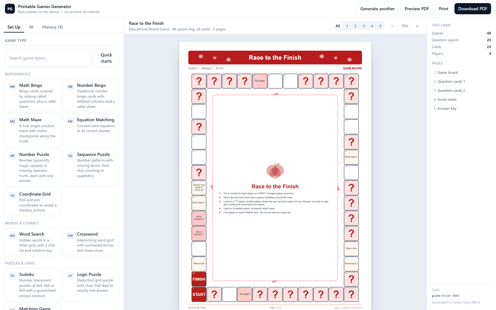
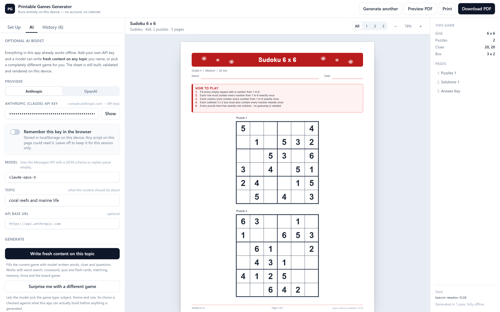
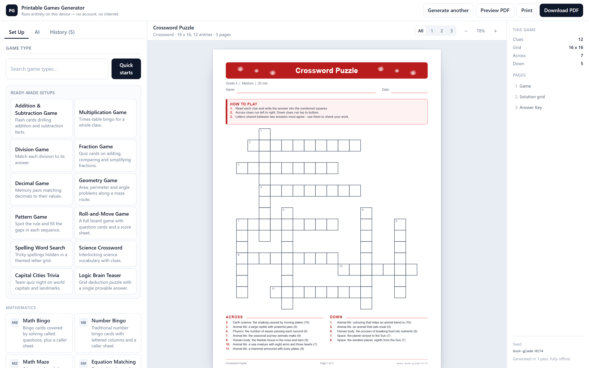
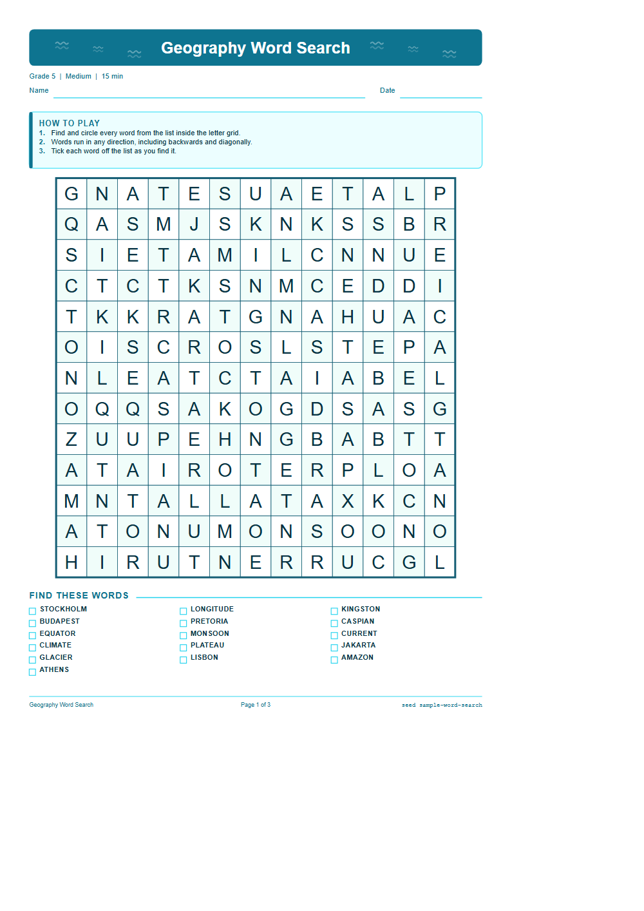
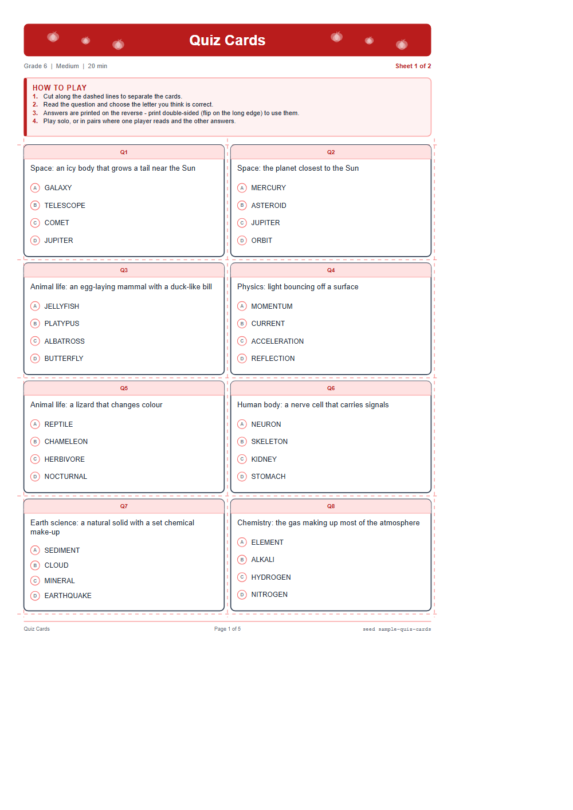
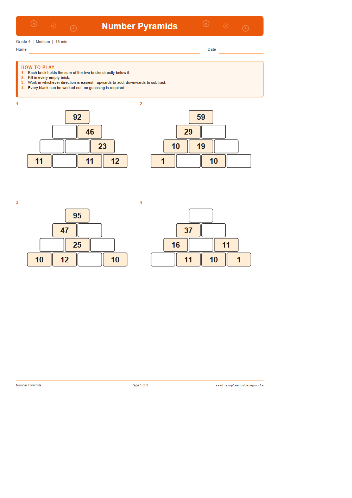

# Printable Games Generator

**A browser-based game factory for teachers. Pick a game type, a grade and a
difficulty, and it builds a complete printable game — board, cards, instructions
and answer key — as a print-ready PDF. It runs entirely on the user's device.**

React · TypeScript · Vite · Tailwind · jsPDF · PWA
18 generators · 297 tests · zero backend

---

## Short version (for a portfolio card)

> A printable-game factory that runs entirely in the browser. Choose a game type,
> grade and difficulty, and a local rule engine builds a complete, unique game —
> board, cards, instructions and answer key — then exports it as a vector PDF.
> 18 game generators, a maths engine whose every answer is independently
> re-verified, and puzzle solvers that guarantee sudoku, mazes and logic grids
> have exactly one solution. Works fully offline as an installable PWA; an
> optional bring-your-own-key AI layer can write fresh content on any topic.

---

## Medium version (for a project page)

Teachers spend real time hunting for worksheets that match the class they
actually have. This app generates them instead: pick **Math Bingo, Grade 5,
Medium, Space theme, 30 players** and get a print-ready PDF with 30 unique bingo
cards, a caller sheet and an answer key — in about 40 milliseconds, with no
account, no server and no internet connection.

It ships **18 game generators** — word search, crossword, sudoku, logic puzzles,
math mazes, bingo, quiz and flash card decks, memory tiles, a roll-and-move board
game, team trivia and more — each configurable across grade (Kindergarten to
adult), difficulty, subject, theme, paper size and orientation.

The engineering problem is not "generate a worksheet." It is **generating
thousands of different worksheets that are all correct and all print properly**,
without a human checking each one. Three ideas do that work:

**One geometric document, three renderers.** Generators don't emit HTML. They
emit a typed drawing IR with every coordinate in millimetres. An SVG renderer
draws the on-screen preview, a print surface handles browser printing, and a
jsPDF renderer produces the file. The preview is therefore byte-identical to what
prints, and a 30-card classroom bingo set is a 26 KB vector PDF with selectable
text rather than a multi-megabyte screenshot.

**Nothing broken reaches the user.** Every generator implements `validate()`, and
the pipeline loops generate → validate → retry before laying anything out. The
finished document is then validated *again* for geometry — elements off the page,
text wider than the box it was given, unreadably small type. Only a document that
passes both is shown.

**Answers are proved, not asserted.** Every generated maths problem carries an
arithmetic expression that re-derives its own answer, and a separate evaluator
checks the two agree — a bug produces a rejected sheet, never a wrong answer key.
The test suite runs this over **37,800 problems** across every topic, grade and
difficulty. The same rigour applies to puzzles: sudoku only removes a cell while
a solver confirms the solution stays unique, the logic-puzzle generator adds
clues until a constraint solver reports exactly one answer and then strips every
clue that isn't load-bearing, and mazes are re-solved from scratch during
validation.

An **optional AI layer** lets a user bring their own Anthropic or OpenAI key so a
model can write fresh content on any topic, or propose an entirely different
game. Model output is treated as untrusted data: it is character-filtered,
length-capped and injection-screened, and any maths it returns goes through the
same expression verifier — a model that states 7 × 8 = 54 produces a shorter
sheet, never a wrong answer key. With no key set, the app makes zero network
requests.

---

## What I'd point at in an interview

| | |
| --- | --- |
| **Hardest correctness problem** | Guaranteeing a *unique* solution. Generating a sudoku is easy; digging holes while proving the answer stays unique needs a solution counter with early exit and most-constrained-cell branching. The logic-puzzle generator was harder still: build a solution, derive every true statement about it, add clues until a real solver reports exactly one consistent assignment, then remove every clue that turns out not to be load-bearing. |
| **Best architectural decision** | The millimetre-based drawing IR. It collapsed "preview," "print" and "export" into one geometry problem with three thin renderers, made page breaks exact, kept PDFs tiny and selectable, and made a whole class of layout bug mechanically detectable. |
| **Most useful invariant** | Font metrics measured through the same engine that draws the text. Layout code can ask "how wide is this at 11pt bold?" while building geometry, which is what powers shrink-to-fit sizing — the reason sheets never overflow no matter what content lands on them. |
| **Where the bugs actually were** | Rendering sample sheets to PNG and *looking at them* caught four real bugs that passing tests had not: overlapping maze questions, half-empty quiz cards, a mostly-black crossword grid, and bingo cards collapsing to 3 mm on the second card of a page. Automated geometry validation catches "off the page"; it does not catch "ugly." |
| **A trade-off I'd defend** | Raw `fetch` instead of the official provider SDKs. Two SDKs would have added significant weight to a bundle that must be fully precached for offline use, for two single-shot JSON calls. I documented the choice rather than hiding it. |
| **Something I verified rather than assumed** | Whether the providers can be called from a browser at all. Anthropic can, with an explicit opt-in header; **OpenAI cannot** — no CORS headers, so a direct browser request fails before it reaches them. Rather than shipping a dead button, the UI states this and offers a proxy base-URL field. |

---

## Numbers

- **18** game generators, each with its own algorithm, validation and printable layout
- **297** tests: every generator × 7 grades × 5 difficulties × every subject × both paper sizes × both orientations × 5 themes × ink-saver × the full item range
- **37,800** maths problems independently re-verified in CI
- **~40 ms** to generate, validate and lay out a typical game
- **26 KB** vector PDF for a 17-page, 30-card classroom bingo set
- **0** network requests without an API key — verified by killing the server and reloading

---

## Screenshots

### The app

| | |
| --- | --- |
|  |  |
| Live preview — exactly what prints | 18 game types, grouped by category |
|  |  |
| Optional bring-your-own-key AI layer | One-click presets for common classroom games |

### Generated sheets

| | | |
| --- | --- | --- |
|  |  |  |
|  |  |  |
|  |  |  |

---

## Stack

**React 18 · TypeScript (strict) · Vite · Tailwind CSS · jsPDF · Vitest ·
vite-plugin-pwa**

No component library, no state manager, no backend. All dependencies are open
source and bundled locally; there are no runtime network calls unless the user
supplies an API key.

---

## Try it

```bash
npm install
npm run dev
```

Full documentation is in [`README.md`](README.md); the architecture walkthrough
for adding a new game type is in [`docs/ADDING_GAMES.md`](docs/ADDING_GAMES.md).
