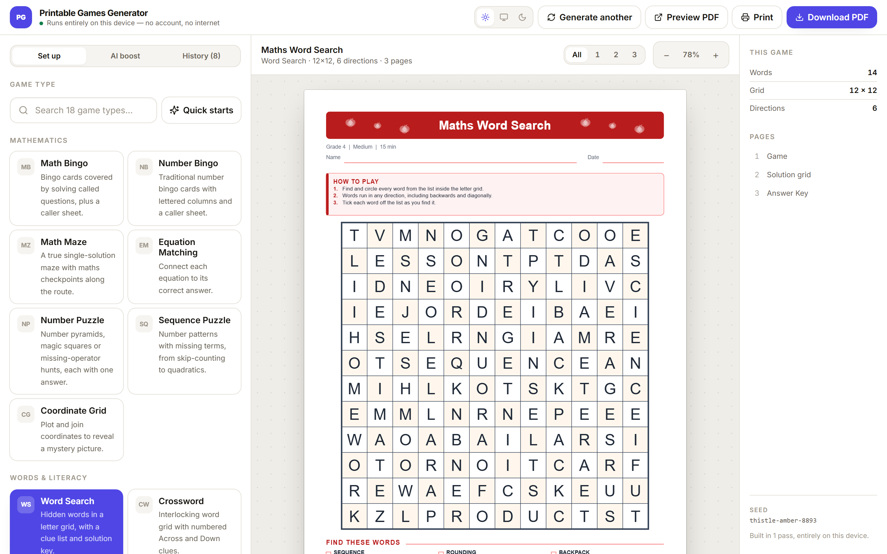
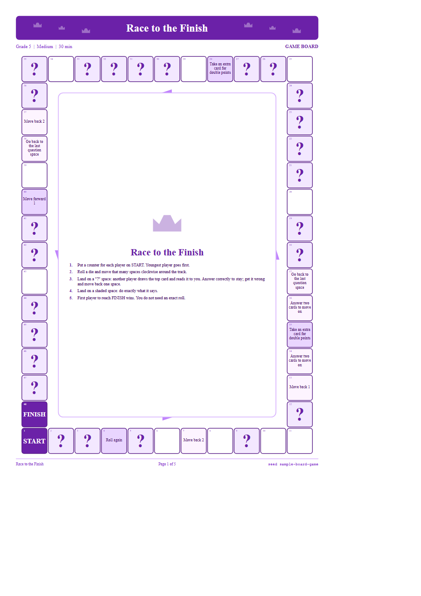
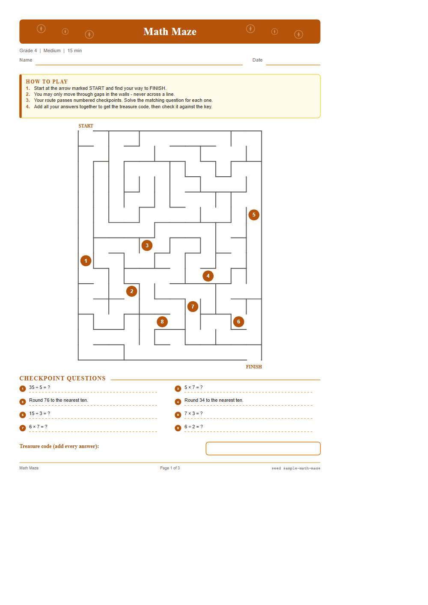
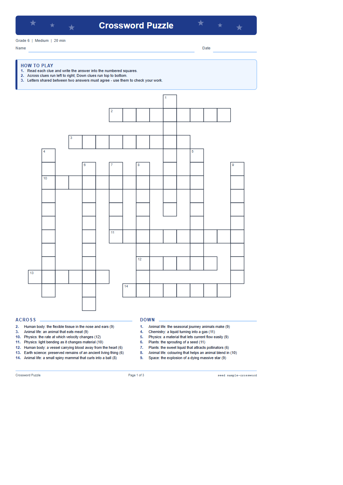
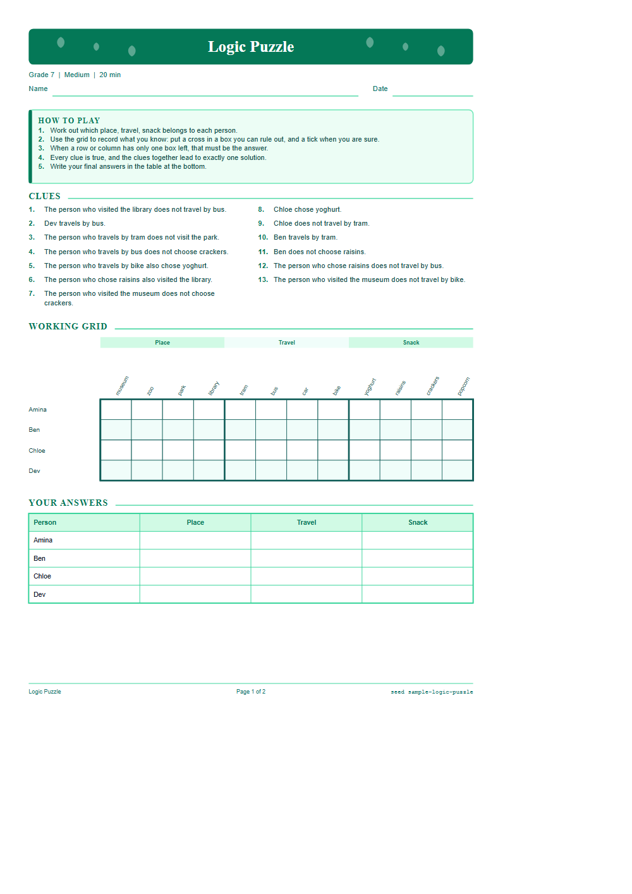
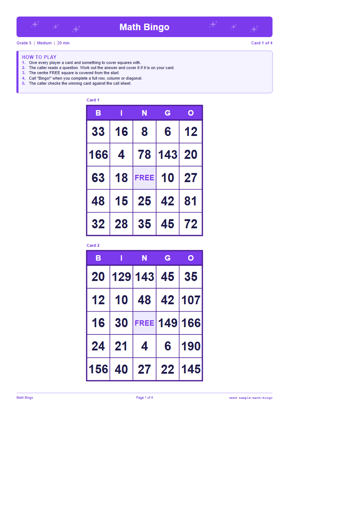
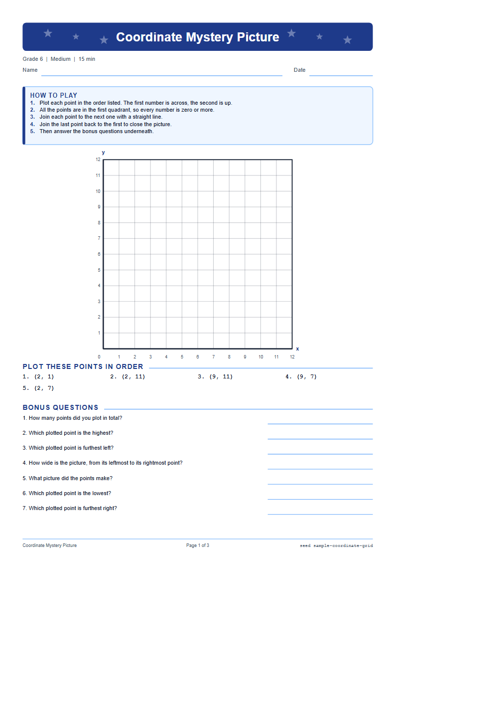

# Printable Games Generator

A printable-game factory that runs entirely on your own machine. Choose a game
type, a grade, a difficulty and a theme, and it builds a complete, unique,
print-ready game — board, cards, instructions and answer key — then hands you a
PDF.

**No account. No server. No API key needed.** Every rule, equation, word bank and
layout algorithm ships inside the app. Once the page has loaded, you can unplug
the network and keep generating games forever.

An **optional AI layer** is available if you want it: supply your own Anthropic
or OpenAI key and a model can write fresh content on any topic you name, or pick
a different game entirely. It is strictly additive — with no key set, the app
makes zero network requests. See [AI boost](#ai-boost-optional).

<p>
  
  
  
  
  
  <a href="https://printable-games-generator.vercel.app"></a>
</p>

**▶ Try it live: [printable-games-generator.vercel.app](https://printable-games-generator.vercel.app)** — no sign-up,
no account. Load it once, then turn off your Wi-Fi; it keeps working.



*The whole app: pick a game on the left, and the preview on the right is the
exact page that prints. 18 generators, live regeneration, PDF in one click.*

---

## Contents

- [What it makes](#what-it-makes)
- [Quick start](#quick-start)
- [Offline use](#offline-use)
- [AI boost (optional)](#ai-boost-optional)
- [How it works](#how-it-works)
- [Project layout](#project-layout)
- [Adding a new game type](#adding-a-new-game-type)
- [Testing](#testing)
- [Design decisions worth knowing](#design-decisions-worth-knowing)
- [Deployment](#deployment)

---

## What it makes

18 generators, each with configurable difficulty, its own validation rules, a
printable layout and an answer key.

| Category | Games |
| --- | --- |
| **Mathematics** | Math Bingo · Number Bingo · Math Maze · Equation Matching · Number Puzzle (pyramids / magic squares / operator hunts) · Sequence Puzzle · Coordinate Grid |
| **Words & literacy** | Word Search · Crossword |
| **Puzzles & logic** | Sudoku (4×4, 6×6, 9×9) · Logic Puzzle · Matching Game |
| **Cards** | Quiz Cards · Flash Cards · Memory Cards · Challenge Cards |
| **Board & trivia** | Educational Board Game · Trivia Game |

Plus **Quick starts** — one-click presets for the games teachers ask for by name
(Multiplication Game, Fraction Game, Geometry Game, Roll-and-Move Game, …), each
of which is a generator plus a tuned configuration.

### Every game is configurable by

Grade (Kindergarten → Grade 10 → Adult) · Difficulty (Very Easy → Very Hard) ·
Subject (Maths, English, Science, Geography, History, General Knowledge, Logic,
Vocabulary) · Maths topic (18 strands) · Players · Game length · Item count ·
Theme (10) · Paper size (A4 / US Letter) · Orientation · Instructions on/off ·
Answer key on/off · Cutting guides · Name & date line · Ink saver.

---

## What it looks like

<table>
<tr>
<td width="50%"></td>
<td width="50%"></td>
</tr>
<tr>
<td><b>Educational Board Game</b> — a 48-space ring, question cards, a score sheet and an answer key. The rules are printed in the middle of the board.</td>
<td><b>Math Maze</b> — a real single-solution maze with maths checkpoints on the route. The answer key draws the solved path.</td>
</tr>
<tr>
<td></td>
<td></td>
</tr>
<tr>
<td><b>Crossword</b> — interlocking placement with proper Across/Down numbering, cropped to its bounding box.</td>
<td><b>Logic Puzzle</b> — clues, a working grid and an answer table. Every puzzle has exactly one provable answer.</td>
</tr>
<tr>
<td></td>
<td></td>
</tr>
<tr>
<td><b>Math Bingo</b> — up to 30 unique cards plus a caller sheet, no two alike.</td>
<td><b>Coordinate Grid</b> — plot the points and a hidden picture appears on the solution page.</td>
</tr>
</table>

More in [`screenshots/`](screenshots). The design notes and an
interview-oriented walkthrough are in [`PORTFOLIO.md`](PORTFOLIO.md).

---

## Quick start

```bash
npm install
npm run dev
```

Open the URL Vite prints. Then:

1. Pick a **game type** on the left (or open **Quick starts**).
2. Set the **grade** and **difficulty**. The panel tells you exactly what those
   settings will produce ("Numbers 1 to 100", "Up to 2 steps per question", …).
3. The preview regenerates as you type — it is the exact printable page, not an
   approximation.
4. **Generate another** for new content with the same settings.
5. **Download PDF** or **Print**.

Build a production bundle:

```bash
npm run build
```

The result in `dist/` is a static site. Host it anywhere, or open it from a USB
stick — there is no backend.

---

## Offline use

The app is a Progressive Web App.

- **Install it**: open the built site in Chrome or Edge and use *Install app*.
  It then runs from your dock or Start menu with no browser chrome.
- **Use it offline**: a service worker precaches the whole application on first
  load. After that, everything — generation, preview, PDF export — works with no
  network at all.
- **Your data stays local**: generated games are saved in `localStorage` in your
  browser. Nothing is uploaded, and there is no telemetry.

To confirm: load the app once, turn off your network, reload, and keep working.

---

## AI boost (optional)

The **AI** tab accepts your own API key and unlocks two actions. Neither is
required, and neither changes how a sheet is built, validated or rendered — the
model only supplies raw material.

| Action | What it does |
| --- | --- |
| **Write fresh content on this topic** | The model writes terms, clues, questions and words about any topic you name. They flow into word search, crossword, quiz and flash cards, matching, memory, trivia and the board game — so you can make a crossword about the water cycle, or a quiz deck on your own syllabus. |
| **Surprise me with a different game** | The model picks the game type, subject, theme and size from this app's own registry. Its choice is clamped against what the app can actually build before anything is generated. |

### Model output is treated as untrusted data

This is the part that matters. Everything a provider returns is text of unknown
provenance heading for a page a child will read, so it passes through
`src/ai/sanitize.ts` before anything trusts it:

- **Structure** — wrong-shaped entries are dropped, never coerced.
- **Characters** — anything outside the printable set the PDF fonts can render is
  stripped, so no entry can come out as garbage glyphs.
- **Length** — hard caps, so no single item can break a layout.
- **Injection** — text that reads as an instruction to the app rather than as game
  content is discarded, and the model never writes the printed instructions.
- **Meaning** — any maths answer is re-derived through the same expression
  evaluator the local engine uses. **A model that states 7 × 8 = 54 produces a
  shorter sheet, never a wrong answer key.**

Whatever survives is used first, then topped up from the built-in libraries, so a
thin or partly-rejected batch still yields a complete game.

### Keys and privacy

- The key is held in memory for the session. It is written to `localStorage`
  **only** if you tick "remember", and the UI says plainly what that means.
- Sent to your chosen provider: the topic, grade, difficulty and subject. Nothing
  else — not your games, not your history.
- Requests bill your own account at your provider's rates. Nothing is proxied.

### Browser reachability

| Provider | Callable directly from a browser? |
| --- | --- |
| **Anthropic** | Yes — the app sends `anthropic-dangerous-direct-browser-access`. |
| **OpenAI** | **No.** Their API sends no CORS headers, so the request is blocked before it reaches them. Use the **API base URL** field to point at your own proxy. |

The app states this in the UI rather than shipping a button that silently fails.

---

## How it works

```
Game definition                     which generator, and what it can do
        ↓
Input configuration                 grade, difficulty, subject, theme, paper…
        ↓
Difficulty rules                    engines/difficulty.ts → one 0-100 score → every knob
        ↓
Content generator                   engines/equations.ts (maths) · engines/content.ts (facts)
        ↓
Game mechanics                      the generator's own algorithm
        ↓
Validation engine                   engines/validation.ts — reject and retry
        ↓
Layout engine                       engines/layout/* → a PrintDoc
        ↓
Printable game                      SVG preview · browser print
        ↓
PDF                                 pdf/exportPdf.ts — vector, selectable, small
```

### The two ideas that hold it together

**1. One geometric document, three renderers.**
Generators do not emit HTML. They emit a `PrintDoc` — pages of typed drawing
primitives with every coordinate in millimetres. Three renderers consume it: the
SVG preview, the browser print surface, and the jsPDF exporter. That is why the
preview is byte-for-byte what prints, why the PDF is a 20 KB vector file with
selectable text instead of a 10 MB screenshot, and why page breaks are exact.

**2. Nothing broken reaches the user.**
Every generator implements `validate()`, and the pipeline loops
`generate → validate → retry` (up to 12 attempts, each with a fresh RNG stream)
before laying anything out. The finished document is then validated *again* for
geometry: elements off the page, text wider than the box it was given,
unreadably small type. Only a document that passes both is shown.

The maths goes further. Every generated problem carries an arithmetic expression
that re-derives its answer from the printed question. A separate evaluator
(`engines/expression.ts`) parses that expression and checks the result against
the stored answer, so a bug in a generator produces a rejected sheet rather than
a wrong answer key. The test suite runs this over 37,800 problems spanning every
topic, grade and difficulty.

### Uniqueness and reproducibility

Every random choice comes from a seeded PRNG (`utils/rng.ts`). So:

- the same **seed + configuration** always produces the identical game;
- **Generate another** just changes the seed;
- history entries store only the configuration, and re-open by replaying the
  pipeline — a hundred saved games cost a few kilobytes.

Variation comes from several places at once: seeded randomness, multiple
templates per generator (number puzzles pick between pyramids, magic squares and
operator hunts; word search picks among 8 placement directions), randomised
question pools, shuffled distractors, randomised board and card positions, and
ten themes.

---

## Project layout

```
src/
  components/      React UI — config panel, game picker, SVG preview, history
    ui/            small form primitives (no component library)
  data/            content libraries: geography, science, English, history,
                   maths vocabulary, general knowledge, logic, theme word banks
  engines/
    config.ts      defaults, normalisation, quick-start presets
    content.ts     fact selection with progressive widening
    difficulty.ts  grade + difficulty → one score → every downstream knob
    equations.ts   the maths content engine (18 topics)
    expression.ts  independent arithmetic evaluator used for verification
    pipeline.ts    generate → validate → layout → verify
    registry.ts    the list of installed generators
    validation.ts  content and geometry validation
    layout/
      doc.ts       DocBuilder — the drawing surface
      components.ts headers, instruction panels, card grids, answer keys, footers
      grid.ts      shared grid and table drawing
      motifs.ts    vector theme decorations
      theme.ts     the ten themes and the ink-saver transform
  ai/              optional AI layer - providers, prompts, sanitisation
    client.ts      fetch transport for both providers
    sanitize.ts    the untrusted-input boundary
    contentPack.ts model-written content, verified
    variation.ts   "surprise me", clamped against the registry
  generators/      one file per game type (+ shared.ts, promptSource.ts)
  layouts/
    paper.ts       paper presets and per-category printable margins
  pdf/
    exportPdf.ts   PrintDoc → PDF (jsPDF, vector)
    exportSvg.ts   PrintDoc → standalone SVG
  templates/
    cardSheets.ts  named card-sheet templates and the density chooser
  types/           GameConfig, GameGenerator, PrintDoc and friends
  utils/           seeded RNG, font metrics and text fitting, storage, helpers
tests/             generator, mathematics, PDF and sample suites
docs/              ADDING_GAMES.md
```

---

## Adding a new game type

Three steps, no changes to the UI, the pipeline or the PDF code:

1. Write `src/generators/myGame.ts` exporting an object that satisfies
   `GameGenerator`.
2. Import it in `src/generators/index.ts` and add it to the `GENERATORS` array.
3. Run the tests — the cross-generator suite picks it up automatically and
   exercises it across every grade, difficulty, subject, paper size and theme.

The full walkthrough, with a worked example, is in
[`docs/ADDING_GAMES.md`](docs/ADDING_GAMES.md).

---

## Testing

```bash
npm test          # everything
npm run typecheck # TypeScript, strict mode
```

| Suite | What it covers |
| --- | --- |
| `tests/generators.test.ts` | Every generator × 7 grades × 5 difficulties × every supported subject, both paper sizes, both orientations, 5 themes, ink-saver, the full item-count range, seed reproducibility, and answer-key on/off. |
| `tests/mathematics.test.ts` | The expression evaluator; fraction handling; **every generated maths answer re-verified independently**; no negatives below the grade that introduces them; exact division; distractor quality; difficulty monotonicity. |
| `tests/pdf.test.ts` | Every generator exports a well-formed PDF, page counts match, answer-key exclusion works, paper sizes are correct, SVG output is valid XML, and a 30-card classroom bingo set stays under 1 MB. |
| `tests/samples.test.ts` | One representative sheet per game type. Set `SAMPLE_DIR` / `PDF_DIR` to write them out for visual inspection. |
| `tests/ai.test.ts` | The untrusted-input boundary: malformed, hostile and factually wrong model output pushed through the sanitiser, plus content-pack injection and variation clamping. |

To eyeball real output:

```bash
SAMPLE_DIR=./out PDF_DIR=./out npx vitest run tests/samples.test.ts
```

---

## Design decisions worth knowing

**Millimetres everywhere.** The `PrintDoc` IR uses millimetres with the origin at
the top-left of the page, matching jsPDF's document units exactly. No coordinate
conversion happens in the PDF exporter, which removes an entire class of
off-by-a-scale-factor bugs.

**Font metrics come from the PDF engine.** `utils/text.ts` measures strings
through a hidden jsPDF instance — the same engine that will draw them. Layout
code can therefore ask "how wide is this at 11pt bold?" while building geometry,
which is what powers the shrink-to-fit behaviour that stops content overflowing.
The SVG preview then pins each text run to that measured width with `textLength`,
so preview and PDF agree even if the browser's Helvetica differs.

**Puzzles are solved, not asserted.** Sudoku digs holes only while a solver
confirms the solution is still unique. The logic puzzle adds clues until a real
constraint solver reports exactly one solution, then removes every clue that
turns out not to be load-bearing. The maze is re-solved from scratch during
validation. Number puzzles are checked by constraint propagation, permutation
search or operator enumeration depending on the variant.

**Difficulty is one number.** Grade and difficulty collapse into a single 0–100
score, and every downstream knob — number ranges, operation ladder, grid sizes,
word lengths, vocabulary tier, sudoku box size, clue generosity, distractor
tightness — is a ramp off that score. Adding a knob means adding one ramp, not a
12 × 5 lookup table.

**Content is data, not code.** One `FactItem` shape (`term`, `clue`, `category`,
`subject`, `tier`) feeds word search, crossword, matching, quiz, flash, memory
and trivia. Adding a topic is a data edit that immediately benefits seven games.

**Duplex printing is handled once.** Card backs are laid out with columns
mirrored left-to-right, so long-edge duplex printing lands each answer behind its
own question. That is the classic flash-card printing failure, and it lives in
exactly one function.

---

## Deployment

Live at **[printable-games-generator.vercel.app](https://printable-games-generator.vercel.app)**, hosted on Vercel as
pure static files — there is no server component to deploy, because there is no
server.

```bash
npm run build      # -> dist/  (~1.2 MB, 15 files precached by the service worker)
```

That `dist/` folder is the entire application. Any static host will serve it —
Vercel, Netlify, GitHub Pages, S3, a USB stick. The build uses `base: './'`, so
it also runs from a `file://` path with no web server at all.

[`vercel.json`](vercel.json) exists for one reason: **the cache headers a PWA
needs in order to update.**

| Path | `Cache-Control` | Why |
| --- | --- | --- |
| `/sw.js`, `/registerSW.js` | `max-age=0, must-revalidate` | A visitor holding a cached service worker has to re-fetch it, or a new deploy never reaches them |
| `/index.html`, `/manifest.webmanifest` | `max-age=0, must-revalidate` | These name the hashed bundles; a stale copy points at files that no longer exist |
| `/assets/*`, `/workbox-*.js` | `max-age=31536000, immutable` | Content-hashed — the filename changes whenever the bytes do |

Two things it deliberately does **not** do:

- **No SPA catch-all rewrite.** There is no client-side router, and the build
  uses a relative `base`. Rewriting unknown paths to `index.html` would serve a
  page whose `./assets/…` URLs resolve against the invented path and 404. A real
  404 is the honest answer.
- **No Content-Security-Policy.** The PDF preview runs on `blob:` object URLs and
  the opt-in AI panel calls `api.anthropic.com` straight from the page. A policy
  has to be written against both before it is safe to enable, and a broken CSP is
  worse than none.

To deploy your own copy:

```bash
npm i -g vercel
vercel --prod
```

---

## Licence and dependencies

All dependencies are open source and bundled locally: React, jsPDF, Tailwind CSS,
Vite, `vite-plugin-pwa`, Vitest. There are no runtime network calls of any kind.
